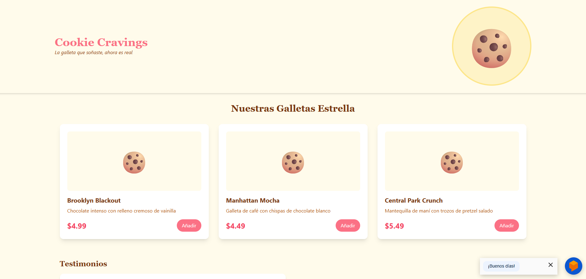
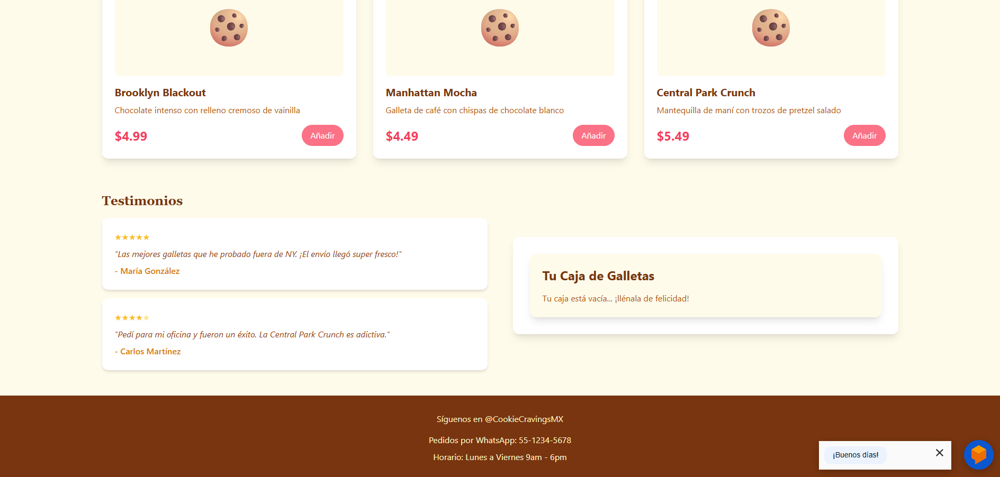
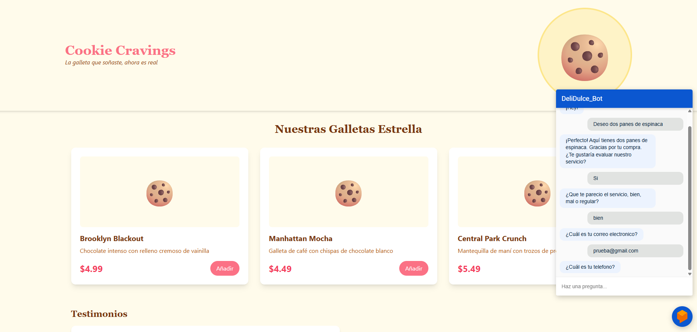

<div align="center">

# 🍪 Cookie Cravings

**Tienda en línea de galletas estilo Nueva York con un chatbot de IA que atiende a los clientes 24/7.**




</div>

---

## 📌 Descripción

**Cookie Cravings** es una tienda de galletas estilo Nueva York y panes artesanales. El proyecto combina:

1. Una **tienda web en React** con catálogo de productos, testimonios y carrito de compras.
2. Un **chatbot con IA (Dialogflow)** integrado en la página, que resuelve las preguntas frecuentes de los clientes al instante.

## ✨ Funcionalidades

**Tienda**
- 🛍️ Catálogo de productos con tarjetas.
- 🛒 Carrito de compras.
- 💬 Sección de testimonios de clientes.

**Chatbot**
- 🤖 Responde preguntas sobre productos, horarios y envíos.
- 🧭 Guía al cliente en el proceso de compra y **toma pedidos** desde el chat.
- 📝 Hace una **encuesta de satisfacción** y pide los datos de contacto del cliente.
- 🌙 Disponible 24/7 desde cualquier dispositivo, en español.

## 💬 Intenciones del chatbot

| Intención | Ejemplo de pregunta | Respuesta |
|---|---|---|
| `sabores_disponibles` | "¿Qué sabores tienen?" | Lista de sabores con sugerencias |
| `metodos_envio` | "¿Hacen envíos a domicilio?" | Detalles de envíos y recogida |
| `proceso_pedido` | "¿Cómo hago un pedido?" | Instrucciones para comprar |
| `horario_atencion` | "¿A qué hora abren?" | Horario comercial |

## 📸 Capturas

<div align="center">


</div>

## 🗂️ Estructura

```
├── public/index.html         # Integración del widget de Dialogflow Messenger
└── src/
    ├── App.js
    ├── components/           # CookieHeader, CookieProductCard, CookieCart
    └── mock/                 # Productos y testimonios de ejemplo
```

## 🚀 Cómo ejecutarlo

```bash
git clone https://github.com/JuanB12/Cookie_Cravings.git
cd Cookie_Cravings
npm install
npm start
```

Para usar tu propio chatbot, crea un agente en [Dialogflow](https://dialogflow.cloud.google.com/) y reemplaza el `agent-id` en `public/index.html`:

```html
<script src="https://www.gstatic.com/dialogflow-console/fast/messenger/bootstrap.js?v=1"></script>
<df-messenger intent="WELCOME" chat-title="CookieCravings" agent-id="TU_AGENT_ID" language-code="es"></df-messenger>
```

---

<div align="center">

Hecho por **[Juan Barrios](https://github.com/JuanB12)** · Backend Developer 🐍

</div>
